 

 

## `$ whoami`

I build **generative AI products end to end**, from LLM agents and RAG pipelines to the UI people actually use.
Full Stack AI Engineer with **1+ year of experience**, based in Ghaziabad, India, and **open to roles** in GenAI, AI/ML and Full Stack AI.
MCA in Artificial Intelligence (CGPA 8.9/10) with a strong base in machine learning, deep learning, NLP and MLOps on AWS.

| **1+** | **11+** | **366K+** | **150+** |
|:---:|:---:|:---:|:---:|
| year building production AI | Claude-powered AI features | documents in the IRS RAG corpus | tax form types detected |

 

## `$ now --working-on`

**Full Stack Developer (AI) at [Accumax](https://accumax.ai)** · Sep 2025 to present

I own all AI features of a FinTech tax practice platform, now in **pilot testing with 10 firms**.

- **11+ generative AI features** on Anthropic Claude, each backed by dedicated sub-agents: AI Tax Planner, Return Reviewer and Preparer, Tax Engine, AI Profiler, AI Rewrite, Client Letter Generator and a Lead Generation Chatbot.
- **Multi-agent orchestration** for the Research Chatbot and Audit Defense Assistant, with **two RAG pipelines** on Azure AI Search and Azure Functions over a 366K+ document IRS corpus and firm files.
- **Form Sniffer** (document parsing and regex) that classifies 150+ tax form types, and **Collab Desk**, a real-time collaboration workspace on LiveKit.
- Stack: Angular, TypeScript, Node.js, Express.js, MongoDB.

 

## `$ ls projects/`

<table>
  <tr>
    <td width="50%" valign="top">
      <h4><a href="https://github.com/tushararora-dev/uber-demand-prediction">Uber Demand Forecasting</a></h4>
      Time-series pipeline predicting cab demand across <b>30 city regions</b> at 15-minute intervals, reaching <b>7.9% MAPE</b>. Tuned with Optuna, tracked in MLflow, served on Streamlit. 
      Scikit-learn · Optuna · MLflow · DagsHub · AWS · Streamlit
    </td>
    <td width="50%" valign="top">
      <h4><a href="https://github.com/tushararora-dev/Spotify-Hybrid-recommendation">Spotify Hybrid Recommender</a></h4>
      <b>70% collaborative + 30% content-based</b> filtering with diversity-aware ranking. Productionized with CI/CD, Docker and AWS using blue-green deployment. 
      Dask · DVC · Docker · Pytest · AWS
    </td>
  </tr>
  <tr>
    <td width="50%" valign="top">
      <h4><a href="https://github.com/tushararora-dev/Complete-Self-Driving-Car-main">Self-Driving Car, End-to-End</a></h4>
      NVIDIA-style <b>CNN</b> mapping camera frames to steering and throttle in the Udacity simulator, <b>0.03 validation loss</b>, real-time predictions over Flask and SocketIO. 
      TensorFlow · Keras · OpenCV · Flask · SocketIO
    </td>
    <td width="50%" valign="top">
      <h4><a href="https://github.com/tushararora-dev/Repo_RAG">GitHub Repository RAG Chatbot</a></h4>
      Chat with any GitHub repository: fetches the code, splits it into semantic chunks, stores them in a vector database and answers with retrieval-augmented generation. 
      RAG · Vector DB · Streamlit · LLMs
    </td>
  </tr>
  <tr>
    <td width="50%" valign="top">
      <h4><a href="https://github.com/tushararora-dev/Marketing-Creating-Agent">Marketing Multi-Agent System</a></h4>
      AI-powered multi-agent system that automates marketing workflows, from research and strategy to content creation and campaign execution. 
      Agentic AI · Multi-agent · Python
    </td>
    <td width="50%" valign="top">
      <h4><a href="https://github.com/tushararora-dev/Advanced_Securifide_Advisory_Task">Threat Intelligence Pipeline</a></h4>
      Ingests open-source threat feeds, normalizes, enriches and deduplicates them, and exposes the data through a Flask REST API with a visual frontend. 
      Python · Flask · REST API
    </td>
  </tr>
</table>

[All repositories →](https://github.com/tushararora-dev?tab=repositories)

 

## `$ cat stack.txt`

 

## `$ git log --career`

| When | Where | What |
|---|---|---|
| Sep 2025 to now | **[Accumax](https://accumax.ai)** · Full Stack Developer (AI) | 11+ Claude features, multi-agent workflows, RAG over 366K+ documents |
| Sep to Nov 2024 | **[Banao Technologies](https://banao.tech)** · AI/ML Engineer Intern | Selected from 200+ candidates; course-generating AI agent; WhatsApp warehouse bot on Twilio |
| Jun to Aug 2024 | **[SynapseHealthTech](https://synapsehealthtech.com)** · ML Engineer Intern | Built and tuned 11 ML models (arrhythmia, thyroid detection) shown in hospital demos |

**Education:** MCA in Artificial Intelligence, Jain (Deemed-to-be University), CGPA 8.9/10 · BCA in Data Science, CGPA 8.0/10.
**Also done:** Forage job simulations for Cognizant, BCG X, TATA and Accenture.

 

**Open to Full Stack AI, GenAI and ML roles.** Say hi at [tushar.ai.dev@gmail.com](mailto:tushar.ai.dev@gmail.com) or on [LinkedIn](https://www.linkedin.com/in/tushararora-dev/).

Want the interactive version? Open the <a href="https://tushararora-dev.github.io">portfolio</a> and use W A S D to move around.

